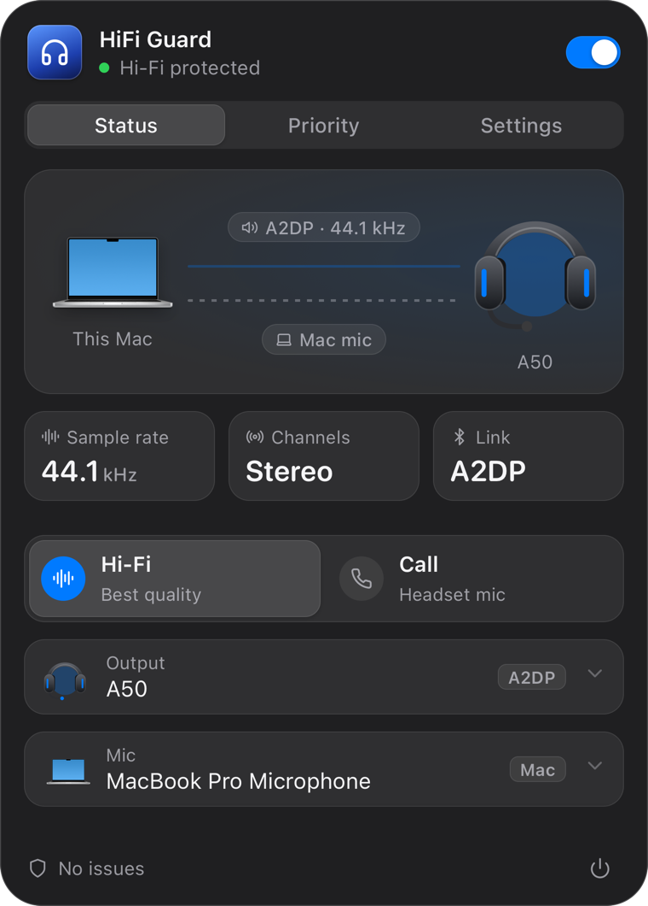
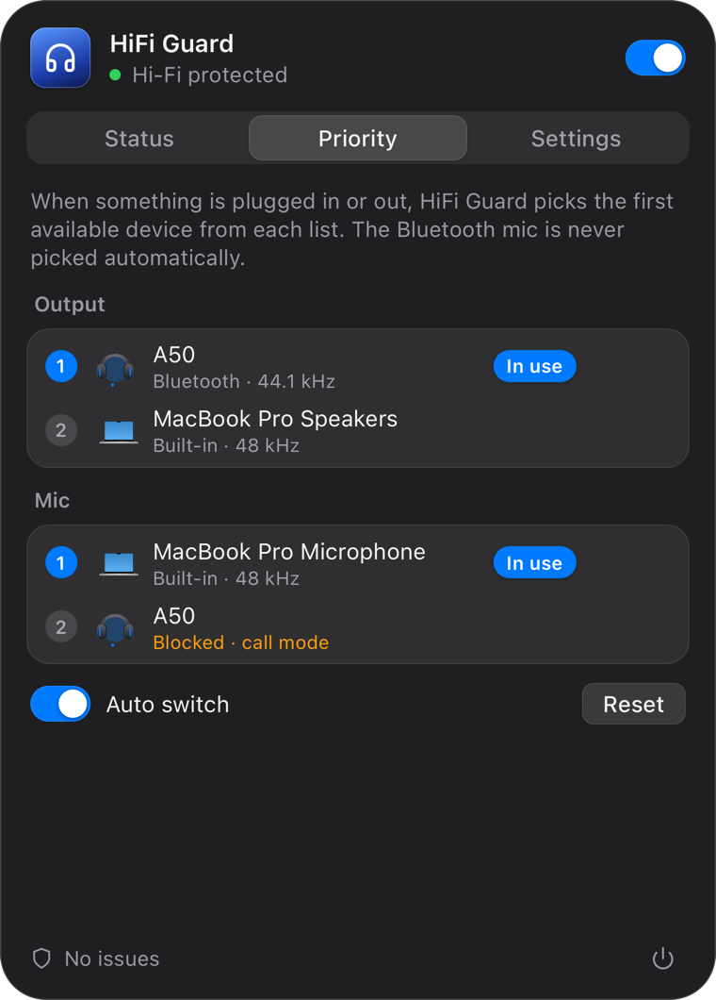
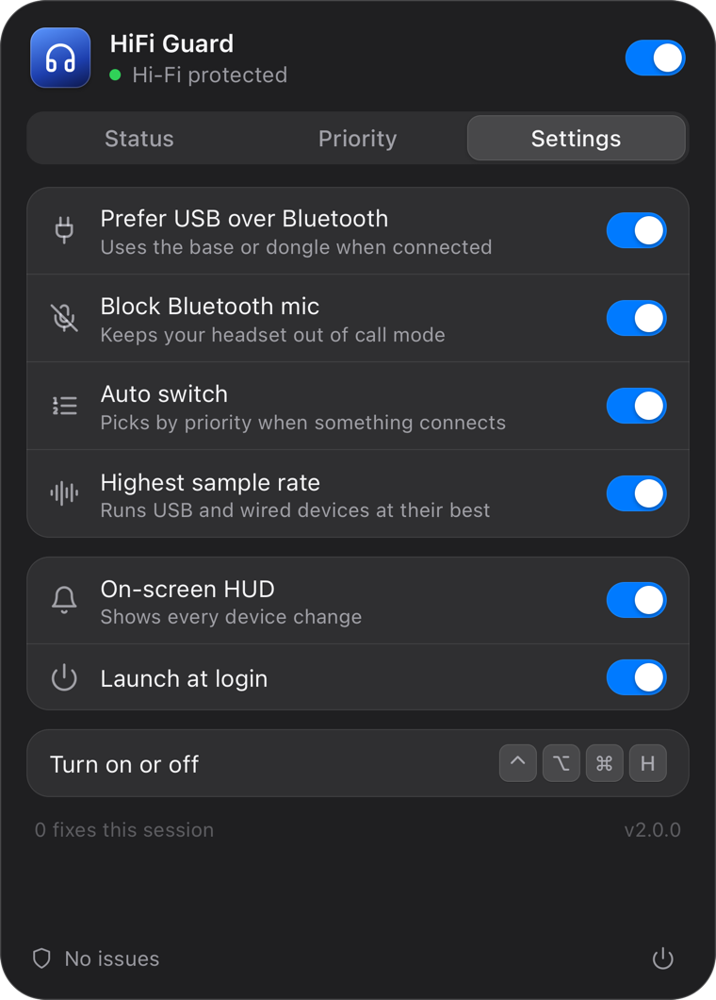

# HiFi Guard

**Bluetooth headphones sounding like a phone call on your Mac? HiFi Guard stops it.**

A tiny macOS menu bar app that keeps your headset out of Bluetooth **call mode**.

Your music or game audio turns muffled and mono the moment you join Discord, Zoom or a browser call. That's this problem, and it isn't your headphones.

When any app (Discord, Zoom, a browser…) opens a Bluetooth headset's microphone, macOS switches the headset from A2DP (stereo, 44.1/48 kHz) to the hands-free profile (HFP: mono, 16 kHz). Everything starts sounding like a phone call. HiFi Guard stops that from happening by routing audio sensibly, automatically.

<p align="center">
  
  
  
</p>

## Install

Requires macOS 14 or later, on Apple silicon or Intel.

1. Download `HiFi-Guard-<version>.zip` from [Releases](https://github.com/jaretcaceres/hifi-guard/releases/latest).
2. Unzip it and move **HiFi Guard** to Applications.
3. Open it. It lives in the menu bar and has no Dock icon.

If macOS says it can't verify the app, the release isn't notarized yet. Go to **System Settings → Privacy & Security** and choose **Open Anyway**, or [build it yourself](#build).

## What it does

- **Headsets with a USB base or dongle** (e.g. Logitech A50: `A50 Game` / `A50 Mic`): output and mic go through USB at full quality instead of the Bluetooth link.
- **Bluetooth only**: the headset stays in A2DP stereo and the mic moves to the best other input (USB mic, or the Mac's built-in one).
- **Never auto-selects a Bluetooth mic**, the thing that triggers call mode.
- **Tells you which app forces the Bluetooth mic** (e.g. Discord with a hard-coded input device) and how to fix it.
- **Device priority**: when something is plugged in or out, it picks the first available device from your ordered lists.
- **Highest sample rate** for wired/USB devices.
- On-screen HUD for every change, global hotkey <kbd>⌃⌥⌘H</kbd>, launch at login.
- Native Liquid Glass menu (macOS 26+), following your accent colour and light/dark mode.

## What it can't do

Bluetooth Classic has no profile that carries stereo audio *and* a microphone at the same time, so no software can give you the headset's own mic over Bluetooth without call mode. Bluetooth LE Audio can, but it needs both the Mac and the headset to support it. If you need the headset mic, use its USB base/dongle; HiFi Guard picks it automatically.

## Lightweight by design

- **No polling.** It talks to Core Audio directly and sleeps until the system reports a change (devices, defaults, Bluetooth profile switches, apps opening a mic): ~0% CPU when idle.
- **~15 MB resident.** The menu runs in a separate short-lived process (`hifiguard --menu`), pre-rendered while the pointer is over the menu bar icon and gone when it closes, together with its WebKit helpers.
- **~1 MB per architecture**, written in Rust.

## Build

Requires macOS 14+ (Liquid Glass on macOS 26+) and a Rust toolchain.

```bash
./build.sh              # builds target/HiFi Guard.app
./build.sh --install    # replaces /Applications/HiFi Guard.app and launches it
./build.sh --universal  # builds for Apple silicon and Intel
cargo test              # routing policy tests; no audio hardware needed
```

Local builds are ad-hoc signed. Set `HIFIGUARD_SIGN_IDENTITY` to a Developer ID to sign for distribution.

## Releasing

Set the version in `Cargo.toml`, then push a matching tag such as `v2.0.0`. The release workflow runs the tests, builds a universal app and creates a draft GitHub release.

Without Apple credentials the build is ad-hoc signed. To sign and notarize it, and to generate the Homebrew cask, add these repository secrets:

| Secret | What |
| --- | --- |
| `APPLE_CERTIFICATE_P12` | Developer ID Application certificate, as base64 |
| `APPLE_CERTIFICATE_PASSWORD` | Password of that `.p12` file |
| `APPLE_SIGN_IDENTITY` | Identity name, e.g. `Developer ID Application: Name (TEAMID)` |
| `APPLE_ID` | Apple account email |
| `APPLE_TEAM_ID` | Developer team ID |
| `APPLE_APP_PASSWORD` | App-specific password for that account |

## Project layout

| Path | What |
| --- | --- |
| `src/audio.rs` | Minimal hand-written Core Audio bindings and change listeners |
| `src/engine.rs` | Routing policy and settings (`~/Library/Application Support/HiFiGuard/config.json`) |
| `src/macos.rs` | AppKit helpers: Liquid Glass, HUD, Mac product image, launch at login |
| `src/menu.rs` | The menu process (WebView) |
| `src/main.rs` | Resident app: menu bar icon, hotkey, event loop |
| `ui/index.html` | Menu UI |
| `tools/` | Dev scripts: menu bar icons, app icon, audio routing inspection |
| `packaging/` | Homebrew cask template, filled in by the release workflow |
| `.github/workflows/` | CI and releases |

Development flags: `--open` opens the menu at launch, `--hud` shows a sample HUD, `--state` prints the menu state as JSON. Environment: `HIFIGUARD_DEBUG=1` prints timing and view diagnostics from the menu process, `HIFIGUARD_PIN=1` keeps the menu open without focus and `HIFIGUARD_TAB=0|1|2` opens it on a tab (handy for screenshots).

## License

[MIT](LICENSE)
